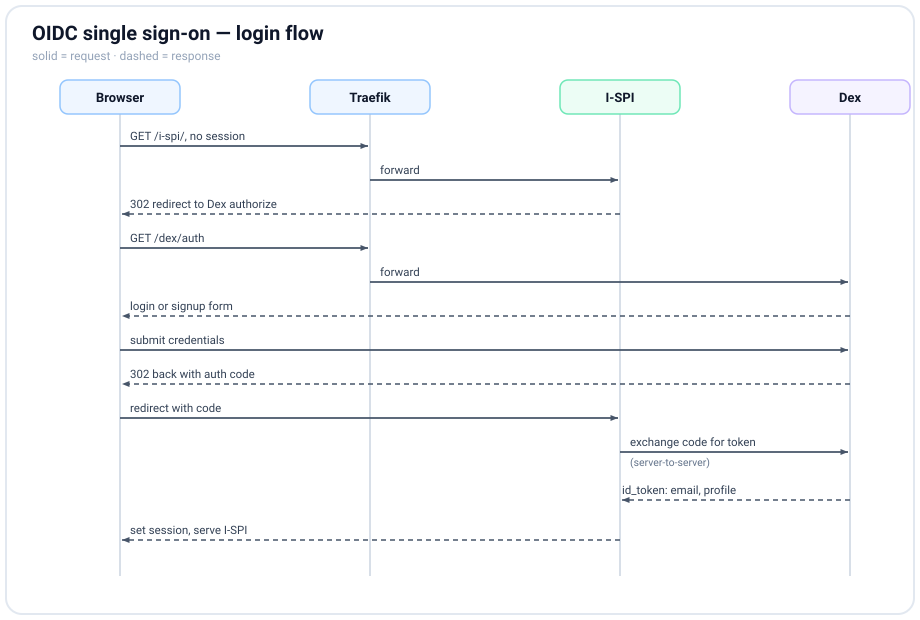
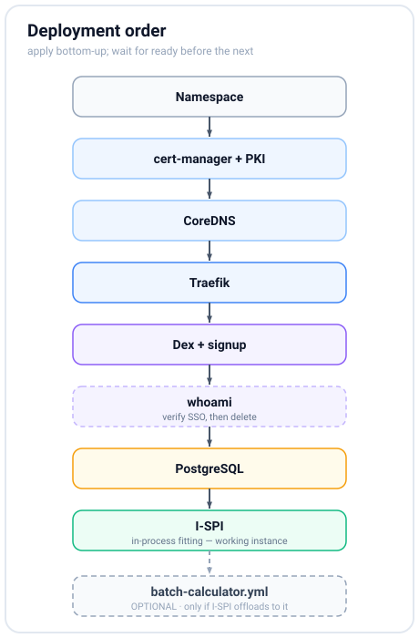

# Standalone I-SPI — Architecture & Planning Guide

This is the conceptual companion to [`README-STANDALONE-ISPI.md`](README-STANDALONE-ISPI.md).
The README is the runbook (which commands, in what order); this guide explains *what you are
building, the choices behind it, and how the pieces fit together*.

It describes a focused analysis instance: **I-SPI, its required i-spi-compute fitting tier, and
their supporting edge, auth, and data layers**. I-SPI does **not** fit curves in-process: it
enqueues fitting jobs to the **i-spi-compute** API, which queues them in Redis for a **curveR**
worker that runs the fits and writes results to the database, which I-SPI then reads back (see
§1 and §3.4–§3.5). A complete, working instance therefore requires i-spi-compute — it is not
optional. The former external **Batch Calculator** (`batch-calculator.yml`) is **retired** and
replaced by i-spi-compute. Data Portal, the platform's data-ingest API/Worker, the platform's
main Redis, and MinIO are out of scope — they belong to the data-sharing portal, not to a
focused analysis instance.

> **A note on names.** The product is *ImmunoPlex*, and everything here now uses that name
> consistently — the `immunoplex` Kubernetes namespace, the `immunoplex` database, the
> `IMMUNOPLEX_*` configuration placeholders, and the `ghcr.io/immunoplex/*` images. You may still
> encounter the project's former name, *immunoodle*, in older clones, image tags, or upstream
> history; they refer to the same project.

---

## 1. What you are deploying

I-SPI (the interactive R Shiny application for Luminex bead-based immunoassay data) is the
visible application. Standing it up means deploying three supporting layers around it — an
**edge / ingress** layer that terminates TLS and routes traffic, an **authentication** layer
that gives every user a single sign-on identity, and a **data** layer.

> **Where the heavy fitting runs — read this first.** I-SPI does **not** fit curves itself.
> When a user requests a fit, I-SPI's compute client (`compute_api_client.R`) **submits a job**
> over HTTP to the **i-spi-compute API**; the API enqueues it in a dedicated **Redis** queue; and
> the **curveR worker** runs the frequentist robust curves and the Bayesian Stan/JAGS ensemble,
> writing the fits and the concentration / se_concentration / pcov results to the `calib_*`
> tables in the shared `immunoplex` database. I-SPI then **reads those results back** from the
> database to display them. The chain is:
>
> **I-SPI enqueues → API → Redis → worker (curveR) → `calib_*` → I-SPI reads.**
>
> The consequence is twofold: i-spi-compute (API + Redis + worker) is a **required** tier, and
> the **worker** — not I-SPI — is the CPU/memory-heavy component. Size the worker accordingly
> (§2.5). The old `batch-calculator.yml` is retired and replaced by i-spi-compute (§3.5).

Everything runs in one Kubernetes namespace (`immunoplex`) as ordinary `Deployment` +
`Service` pairs, with `PersistentVolumeClaim`s for the few things that must survive a restart.
No operator, no Helm, no service mesh — plain YAML applied with `kubectl`.

| Component | Image | Port(s) | Persists data? | Depends on | Role |
|---|---|---|---|---|---|
| **Traefik** | `traefik:v3.5.4` | 80, 443 | No | — | Entry point, TLS, routing |
| **Dex** | `dexidp/dex:v2.44.0-alpine` | 5556, 5557 | Yes (1G PVC, SQLite) | Traefik, cert-manager | OIDC identity provider |
| **dex-account** | `ghcr.io/immunoplex/signup:main` | 8080 | No | Dex (gRPC) | Self-service signup |
| **whoami** *(optional)* | `traefik/whoami`, `oauth2-proxy:v7.8.1` | 80, 8080 | No | Dex | Auth-chain verification |
| **PostgreSQL** | `postgres:17.2` | 5432 | Yes (20G PVC) | — | System of record (`immunoplex` db) |
| **I-SPI** | `ghcr.io/immunoplex/i-spi:main` | 3838 | No (uses PG) | PostgreSQL, Dex, i-spi-compute API | The analysis app (enqueues fits, reads results) |
| **i-spi-compute-api** | `ghcr.io/immunoplex/i-spi-compute-api:main` | 8000 | No | i-spi-compute Redis | **Required.** Job API — accepts/lists/cancels fit jobs |
| **i-spi-compute-redis** | `redis:7` | 6379 | No | — | **Required.** Dedicated job queue for the fitting tier |
| **i-spi-compute-worker** | `ghcr.io/immunoplex/i-spi-compute-worker:main` | — | No (writes PG) | i-spi-compute Redis, PostgreSQL | **Required.** curveR worker — runs fits, writes `calib_*` |

---

## 2. The broad choices to make before you start

### 2.1 Where will it run — your own cluster, or fresh K3s?

The manifests are vanilla Kubernetes and run on any conformant cluster with a default
`StorageClass` that satisfies `ReadWriteOnce` claims and a way to expose a `LoadBalancer`
service. If you have none, `K3S.md` installs single-node K3s. Note K3s is installed with
`--disable=traefik`: this project ships its **own** namespace-scoped Traefik, so the bundled
one is turned off to avoid a conflict.

### 2.2 Connected or air-gapped?

Workloads pull images from public registries by default. For an offline install, follow
`OFFLINE-IMAGES.md`'s save/transfer/load pattern, building the image list from the `image:` fields of
the manifests you actually apply (for this configuration: Traefik, Dex, signup, PostgreSQL,
I-SPI, and the i-spi-compute images — `redis:7`, `i-spi-compute-api`, and
`i-spi-compute-worker` — plus oauth2-proxy/whoami if you keep the test harness). One air-gap trap: the Dex pod's init container downloads its web theme
(`web.zip`) from GitHub on first start; pre-seed the `dex` PVC with the unpacked `web/`
directory at `/var/dex/web` so that download is skipped.

### 2.3 TLS strategy — self-signed CA or your own certificates?

The default path builds a private PKI with cert-manager: a self-signed `root-ca`, an
`intermediate-ca1` it signs, and a `ClusterIssuer` (`intermediate-ca1-issuer`) that every
Ingress references. Certificates are minted automatically into `cert-secret`. The trade-off is
that browsers won't trust this CA until you import the exported root certificate. For a closed
research environment that is fine; for browser-trusted certs without manual import, swap in an
ACME/real-CA `ClusterIssuer` and keep the same annotation pattern on the Ingresses.

### 2.4 Hostname and DNS

A single hostname (`IMMUNOPLEX_HOSTNAME`) is used everywhere — the OIDC issuer, the Ingress
host, and every OAuth redirect URI — and it is baked in at `sed` time. **Choose the name users
will actually type in their browsers.** Mismatches here are the most common failure
(OAuth "redirect URI mismatch"). Pods also need to resolve that hostname internally, which is
why `coredns.yml` maps `IMMUNOPLEX_HOSTNAME → IMMUNOPLEX_IP_ADDRESS` for in-cluster lookups; on
an isolated K3s node you almost certainly need it.

### 2.5 Sizing — the i-spi-compute worker is the heavy component

Fitting no longer runs in the I-SPI pod; it runs in the **i-spi-compute worker** (the curveR
packages: frequentist robust curves plus the Bayesian Stan/JAGS ensemble). So the expensive
computation happens in the worker, and **the worker is the CPU- and memory-bound component** —
not I-SPI.

Practically:

- **i-spi-compute-worker** — give it the cores and RAM. Set its CPU **limit** and the
  `WORKER_CORES` env var to the **same** value (the worker's core detection is not cgroup-aware,
  and `WORKER_CORES` also caps Stan's parallel chains). Stan/JAGS runs are memory-hungry, so keep
  memory generous and scale up for large studies. Running more worker replicas adds throughput —
  each pops the same Redis queue.
- **I-SPI** is now comparatively light: an interactive Shiny front end that submits jobs and
  reads results from the database. Modest CPU/memory is fine; size for concurrent users, not for
  fitting.
- **i-spi-compute-api** and **i-spi-compute-redis** are small (the API is a thin FastAPI job
  broker; Redis just holds the queue).

The documented 4-core / 16 GB floor is adequate for bring-up and light use with a single worker;
production fitting wants a worker sized well above it (and, optionally, more worker replicas).

---

## 3. How the components fit together

### 3.1 Edge: Traefik

Traefik is the only component exposed outside the cluster, as a `LoadBalancer` on 80/443. It
terminates TLS and routes by URL path. It is intentionally namespace-scoped
(`--providers.kubernetesingress.namespaces=immunoplex` plus a namespaced `Role`), so it only
watches `immunoplex`. A `ConfigMap` of middlewares does the path surgery: `i-spi-stripprefix`
removes the `/i-spi` prefix so the app sees its own root, `addslashbyredirect` adds the
trailing slash Shiny needs, `dex-account-stripprefix` serves the signup UI, and
`forcehttpsredirect` pushes HTTP to HTTPS. (The standalone `traefik.yml` drops the Data Portal
middleware, which is unused here.)

### 3.2 Authentication: Dex (+ signup, + optional whoami)

Authentication is OpenID Connect single sign-on with **Dex** as the provider at
`https://HOST/dex`. Dex stores users in a local SQLite database on its PVC
(`enablePasswordDB: true`), so no external identity provider is required. It defines one static
OAuth client (`ImmunoPlex`) whose ID and secret are the `IMMUNOPLEX_OAUTH_CLIENT_ID` /
`IMMUNOPLEX_OAUTH_SECRET` values; the standalone `dex.yml` trims its redirect URIs to just the
I-SPI URLs (and the whoami callback). **dex-account** is the self-service signup UI at
`/dex/account`, talking to Dex over gRPC. **whoami** is an optional harness for proving the
auth chain works before deploying I-SPI — deploy it during bring-up, then delete it.

I-SPI speaks OIDC natively (it holds the client secret), so it needs no proxy in front of it.

A subtlety: the redirect to Dex must use the **public** URL (`https://HOST/dex`) because the
browser follows it, while the server-to-server token exchange uses the **internal** service URL
(`http://dex:5556/dex`). I-SPI receives both as `DEX_ISSUER` and `DEX_INTERNAL_URL`.

### 3.3 Data: PostgreSQL

A single PostgreSQL instance is the system of record, holding the `immunoplex` database (its schema
loaded from `db/`, see `db/README.md`). The deployment is deliberately hardened by an init script: it rewrites
`pg_hba.conf` to **reject all non-TLS connections** and require `md5` over TLS, generates a
self-signed server certificate, and revokes default `PUBLIC` privileges. Because non-TLS is
rejected, every client must connect over SSL — which is why I-SPI connects with `sslmode=require`
(set in `global.R`) and sets `PGSSLCERT=/tmp/postgresql.crt`. The **i-spi-compute worker**
connects to the same database and must likewise use `DB_SSLMODE=require`, or the hardened
PostgreSQL refuses it. Both I-SPI and the worker use the `madi_results` schema: I-SPI for its own
tables and to **read** the `calib_*` fit results, the worker to **write** those results.

### 3.4 The application: I-SPI — and how it fits curves

I-SPI is the R Shiny app on port 3838 — the reason the rest exists. It connects to the
`immunoplex` database over TLS and authenticates users through Dex. It does **not** do the
numerical heavy lifting itself. When a user requests a fit, I-SPI resolves the scope to a set of
`curve_id`s and calls its compute client (`compute_api_client.R`), which POSTs a job to the
i-spi-compute API with an `X-API-Key` header; it then polls the job and, when the worker has
written the `calib_*` results, reads and displays them. I-SPI holds no durable state of its own;
everything persists in PostgreSQL.

The practical consequence is the sizing point from §2.5: the **worker** is the CPU/memory-hungry
component, and I-SPI itself is light.

### 3.5 The i-spi-compute fitting tier (required)

Fitting runs in **i-spi-compute**, deployed from `i-spi-compute.yml` into the same `immunoplex`
namespace. It is three pieces:

- **i-spi-compute-api** (`ghcr.io/immunoplex/i-spi-compute-api:main`, port 8000) — a FastAPI job
  broker. I-SPI submits, polls, lists, and cancels jobs against it; every request except the
  unauthenticated `/health` carries an `X-API-Key` header that must equal the API's `API_KEY`.
- **i-spi-compute-redis** (`redis:7`, port 6379) — a dedicated queue for this tier, password-
  protected with `REDIS_AUTH` (`--requirepass`).
- **i-spi-compute-worker** (`ghcr.io/immunoplex/i-spi-compute-worker:main`) — the **curveR**
  engine. It pops jobs off Redis, runs the frequentist robust curves and the Bayesian Stan/JAGS
  ensemble, and writes the fits and the **concentration**, **se_concentration**, and **pcov**
  outputs to the `calib_*` tables in the `immunoplex` / `madi_results` database. It connects to
  PostgreSQL over TLS (`DB_SSLMODE=require`).

**I-SPI drives this tier.** Its compute client (`compute_api_client.R`) reads two environment
variables — `ISPI_COMPUTE_URL` (the API base URL, e.g. `https://HOST/i-spi-compute`, no trailing
`/jobs`) and `ISPI_COMPUTE_API_KEY` (the shared key) — and POSTs fit jobs to `<URL>/jobs`. So
unlike the retired Batch Calculator, this service is **not** optional and is **not** idle: it is
the only path by which curves get fit. The full loop is:

**I-SPI enqueues → API → Redis → worker (curveR) → `calib_*` → I-SPI reads.**

`i-spi.yml` therefore wires `ISPI_COMPUTE_URL` and `ISPI_COMPUTE_API_KEY` (the latter filled by
the `sed` step to the same value as the API's `IMMUNOPLEX_API_KEY`, so client and server can
never drift). The former `batch-calculator.yml` and its `immunoplex-batch-cal-*` images are
retired; do not deploy them.

### 3.6 Scaling two different ways: worker replicas vs. multiple i-spi-compute stacks

§2.5 already covers running more **worker replicas** against this one deployment's Redis queue —
that's throughput scaling within a single i-spi-compute stack, and it's what `i-spi-compute.yml`
gives you by raising `replicas` on the worker Deployment.

**A second, independent mechanism exists for a different purpose: isolation.** I-SPI can route
different projects or studies to **entirely separate i-spi-compute deployments** — each its own
API, its own dedicated Redis, and its own worker(s), not a shared queue. A project/study's
`compute_cluster` setting (a free-text label in the settings cascade) selects which one: the
label is normalized (lower-cased, `-`→`_`) and matched against `ISPI_COMPUTE_URL__<LABEL>` /
`ISPI_COMPUTE_API_KEY__<LABEL>` environment variable pairs on the I-SPI pod; an unset or
unrecognized label falls back to the "default" `ISPI_COMPUTE_URL`/`ISPI_COMPUTE_API_KEY` pair
every deployment already has. Adding a clone means adding a new env var pair to `i-spi.yml` and
restarting the I-SPI pod — env vars are read at process startup, scanned fresh on every lookup,
so no app code change is needed, but this standalone manifest set doesn't template that wiring
for you; add it by hand if you need a second stack.

Use worker replicas for more throughput against one pool of jobs; use a second i-spi-compute
stack when you need a genuinely separate compute pool — a different group, site, or workload
that shouldn't share capacity or a queue with the default one. (Source: I-SPI's
`compute_cluster_registry.R` and `compute_api_client.R` — not reproduced in this manifest set
since this standalone install only configures the "default" cluster.)

There is a third, independent layer of parallelism **within one worker pod**: `worker_curveR.R`
fits multiple curve groups concurrently via forked child processes (`parallel::mclapply`), each
opening its own database connection, sized by `plan_parallelism()` from the pod's CPU/memory
budget (`WORKER_CORES`, `WORKER_MEM_MB`, clamped by `WORKER_MAX_PARALLEL`) — see
`WORKER_PARALLELISM_NOTES.md` in the I-SPI repo for the full tuning detail. This is why §2.5
says to set the worker's CPU **limit** and `WORKER_CORES` to the same value: the worker's own
core-count detection isn't cgroup-aware, so an unset or mismatched `WORKER_CORES` can
over-fork relative to what the pod is actually scheduled.

---

## 4. Configuration and secrets model

There is no secret manager — configuration is text substitution at install time via the `sed`
step. For this configuration, these placeholders matter:

| Placeholder | How it's set | Used by |
|---|---|---|
| `IMMUNOPLEX_HOSTNAME` | You choose it | Ingresses, OIDC issuer, all redirect URIs |
| `IMMUNOPLEX_IP_ADDRESS` | The host's IP | CoreDNS internal resolution |
| `IMMUNOPLEX_POSTGRES_PASSWORD` | A strong password | PostgreSQL, I-SPI (+ batch worker if deployed) |
| `IMMUNOPLEX_OAUTH_CLIENT_ID` | `openssl rand -hex 32` | Dex client + I-SPI |
| `IMMUNOPLEX_OAUTH_SECRET` | `openssl rand -hex 32` | Dex client + I-SPI |
| `IMMUNOPLEX_REDIS_AUTH` | A strong password | **Required.** i-spi-compute Redis (`--requirepass`), API, and worker — all three must match |
| `IMMUNOPLEX_API_KEY` | `openssl rand -hex 32` | **Required.** i-spi-compute API **and** I-SPI (`ISPI_COMPUTE_API_KEY`) — must match |
| `IMMUNOPLEX_OAUTH_COOKIE_SECRET` | `openssl rand -hex 16` | whoami only (if deployed) |

For a working install you need the first five (hostname, IP, Postgres password, and the two
OAuth values) **plus** `IMMUNOPLEX_REDIS_AUTH` and `IMMUNOPLEX_API_KEY`, because i-spi-compute is
required. `IMMUNOPLEX_OAUTH_COOKIE_SECRET` is only needed if you deploy whoami. Note
`IMMUNOPLEX_API_KEY` is shared by the API and I-SPI, and `IMMUNOPLEX_REDIS_AUTH` by Redis, the
API, and the worker — the single `sed` pass fills each everywhere it appears so the values match.

One consequence worth internalizing: **shared values must match across files** — the OAuth
client secret is identical in `dex.yml` and the `i-spi` Secret, filled by a single `sed` pass so
no manifest reaches into another's Secret. Secrets end up in plain `stringData`; keep the
substituted copies out of version control.

---

## 5. Corrections applied (vs. the original repo manifests)

This configuration depends on these fixes, all documented inline in the manifests. Several were
confirmed against the I-SPI app's own `.env.sample` (the `madi-lumi-reader` container), which is
the authoritative list of variables the app reads.

1. **I-SPI's Dex secret.** I-SPI originally read `DEX_CLIENT_SECRET` from a Secret named
   `data-portal`, created only by `data-portal.yml`. Without Data Portal that Secret is missing
   and I-SPI fails to start. The corrected `i-spi.yml` reads from its own `i-spi` Secret.
2. **I-SPI redirect/logout variable.** The original `REDIRECT_URL: ???` was a placeholder for a
   variable the app does not read — its `.env.sample` documents `DEX_LOGOUT_ENDPOINT` instead
   (matching the sibling Data Portal app). `REDIRECT_URL` is replaced with `DEX_LOGOUT_ENDPOINT`
   set to `https://HOST/i-spi/`. The login redirect itself is handled by `APP_REDIRECT_URI`,
   which was already correct.
3. **Python-engine database credentials.** The `.env.sample` documents a second, uppercase set
   of DB variables (`DB`, `DB_HOST`, `DB_PORT`, `DB_USERID_X`, `DB_PWD_X`) "for python engine,"
   with the same values as the lowercase R-engine set. The original manifest set only the
   lowercase set; the corrected one sets both.
4. **`upload_template_path`.** Documented in the `.env.sample` but omitted by the original
   manifest; now set (back it with a PVC if uploaded templates must persist).
5. **I-SPI resources.** The `resources` block was commented out; now set to tunable starting
   values so the pod is schedulable with sensible bounds.
6. **I-SPI logging.** `SHINY_LOG_LEVEL` is `INFO` for normal operation (was `DEBUG`).
7. **i-spi-compute worker SSL.** The worker connects to the hardened PostgreSQL, which rejects
   non-TLS connections, so its `DB_SSLMODE` must be `require`.

I-SPI **does** have compute-submission wiring: `i-spi.yml` sets `ISPI_COMPUTE_URL` and
`ISPI_COMPUTE_API_KEY`, which the app's `compute_api_client.R` reads to submit fit jobs to the
i-spi-compute API (§3.4, §3.5). The retired Batch Calculator's `BATCH_API_URL`/`BATCH_API_KEY`
variables are gone.

---

## 6. Deployment order

Apply bottom-up so each consumer's dependency is already answering when it starts.

In words: namespace and (on K3s) cert-manager + the CA + CoreDNS first; then Traefik; then Dex
and signup; verify with whoami; then PostgreSQL (create the `immunoplex` database and load
the schema from `db/`, which includes the `calib_*` calibration tables); then **i-spi-compute**
(`i-spi-compute.yml` — Redis, API, worker) since I-SPI's fit path depends on the API being
reachable; then I-SPI — at which point you have a fully working analysis instance. Each
application step should pair `kubectl apply` with `kubectl wait --for=condition=ready` before
moving on, because a dependent pod that starts too early will crash-loop until its dependency is
up.

---

## 7. Verifying a live instance

The end-to-end check for the auth foundation is the **whoami login**: browse to
`https://HOST/whoami`, sign up, log in, and confirm `X-Forwarded-Email` appears. Confirm
PostgreSQL with `select version();`. Confirm the fitting tier is healthy — from inside the I-SPI
pod, `curl https://HOST/i-spi-compute/health` should return
`{"status":"ok","redis":"connected"}` (this also proves I-SPI can reach the API through the
ingress). Then load I-SPI at `https://HOST/i-spi/`, authenticate, and run a fit: I-SPI submits
the job to i-spi-compute, the worker fits the curves and writes `calib_*`, and the results
(concentration / se_concentration / pcov) appear in I-SPI — exercising the whole
enqueue → worker → `calib_*` → read chain.

---

## 8. Day-2 notes

- **Backups.** Durable state is the `immunoplex` PostgreSQL database (both I-SPI's tables and the
  `madi_results` schema, including the `calib_*` fit results) and Dex's SQLite user store on its
  PVC. Use `pg_dump` for the database; don't forget the Dex PVC if you want to preserve user
  accounts. The i-spi-compute Redis queue is transient (in-flight jobs only) and does not need
  backup.
- **Upgrades.** I-SPI's image tracks `:main` with `imagePullPolicy: Always`, so a pod restart
  pulls the latest build. For reproducibility, pin to a specific tag or digest in a controlled
  environment.
- **Scaling.** Fitting runs in the i-spi-compute worker, so the way to fit faster is to give the
  **worker** more CPU/memory (raise its limit and `WORKER_CORES` together) and/or run more worker
  replicas — each pops the same Redis queue, so replicas add throughput across concurrent jobs.
  I-SPI itself scales for concurrent *users*: multiple replicas are possible (it's stateless,
  with the sticky considerations of a Shiny app) and no longer bear the fitting load. PostgreSQL,
  Dex (SQLite), and the i-spi-compute Redis/API are single-instance here.

